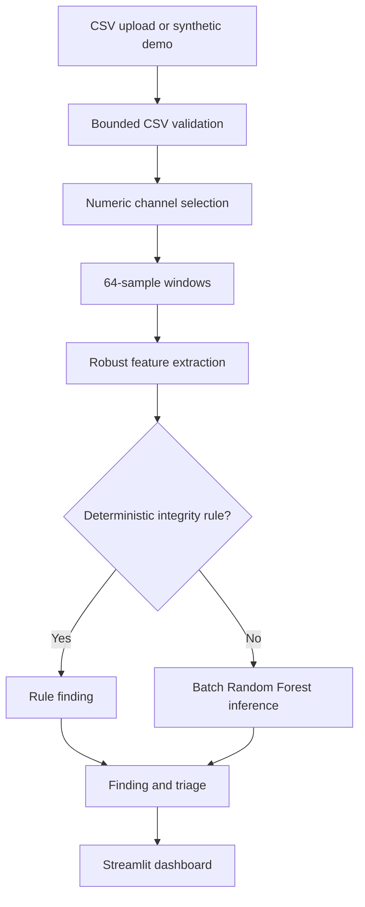

<div align="center">

# TETHER
### Telemetry Health & Event Reliability Engine

**Trust the signal before trusting the decision.**

A lightweight, ML-assisted telemetry integrity gate for motorsport-style time-series data.

**[🚀 Launch Live Demo](https://tether-telemetry-integrity.streamlit.app/)**

`PYTHON` · `SCIKIT-LEARN` · `PANDAS` · `STREAMLIT` · `CPU-FIRST`

</div>

---

> **Live Application:** Access the live interactive dashboard directly at [https://tether-telemetry-integrity.streamlit.app/](https://tether-telemetry-integrity.streamlit.app/) without needing local installation.

---

## Why TETHER exists

Race engineering depends on trustworthy measurements. A sensor can quietly become unreliable long before a dashboard or downstream analysis makes the problem obvious:

- **Dropout** — samples or packets disappear.
- **Stuck-at** — a channel keeps reporting the same value.
- **Drift** — a reading gradually moves away from its expected baseline.
- **Spike** — a sudden, isolated discontinuity appears.
- **Noise** — high-frequency variation obscures the underlying signal.

A misleading signal can create wasted investigation, false alarms, or poor engineering decisions. TETHER is a small inspection layer intended to sit before downstream analytics. It asks a simple question: *is this channel trustworthy enough to use?*

> TETHER is an independent educational prototype. All bundled telemetry is synthetic.

---

## What it does

| Capability | Behaviour |
|---|---|
| **CSV intake** | Validates UTF-8 CSV shape, headers, size, row count and column count |
| **Window analysis** | Breaks continuous channels into 64-sample windows |
| **Feature extraction** | Computes robust statistics, missingness, flatline, trend and derivative features |
| **ML classification** | A compact Random Forest classifies six signal patterns |
| **Integrity rules** | Catches high-signal dropout and stuck-at conditions deterministically |
| **Triage** | Separates `HEALTHY`, `ALERT` and `REVIEW` findings |
| **Engineering guidance** | Suggests the next measurement or acquisition checks to investigate |
| **Demo data** | Provides clean and fault-injected synthetic lap-like CSV files |

### Fault classes

| Class | Interpretation | Default handling |
|---|---|---|
| `NORMAL` | No strong integrity issue detected | Healthy when model score is at least 55%; otherwise review |
| `DROPOUT` | At least 20% of a window is missing/non-finite | Rule-based alert |
| `STUCK` | A long flatline with very low value diversity | Rule-based alert |
| `DRIFT` | The window resembles an unusual sustained trend | **Review only**; a trend alone does not prove sensor drift |
| `SPIKE` | Isolated discontinuity in the first difference | ML alert when score is at least 55% |
| `NOISE` | High-frequency variation relative to the signal | ML alert when score is at least 55% |

A model score is the winning Random Forest class score. It is **not a calibrated probability**, a vehicle safety score, or proof of a mechanical fault. Deterministic rules are identified by `method = RULE`; their model-score cell is left blank.

---

## See it in action

You can test the project immediately via the [Live Demo](https://tether-telemetry-integrity.streamlit.app/) or run it locally:

1. Select **Fault-injected synthetic lap** to inspect deliberate fault signatures:
   - A gradual coolant-temperature trend (review candidate, not an automatic fault verdict).
   - A pressure channel frozen at one value (`STUCK`).
   - Isolated throttle discontinuities (`SPIKE`).
   - Missing RPM samples (`DROPOUT`).
   - A noisy speed segment (`NOISE`).
2. Select **Clean synthetic lap** to compare the baseline. The regression tests require the clean demo to produce no escalated alerts and the injected demo to expose dropout, stuck, spike and noise signatures.
3. Select **Upload a CSV** to inspect your own comma-delimited numeric telemetry.

---

## Architecture



The code is deliberately split by responsibility:

```text
app.py                         Streamlit UI and session flow
src/tether/validation.py       CSV validation and sensor selection
src/tether/features.py         Robust window feature extraction
src/tether/model.py            Synthetic training data and Random Forest
src/tether/analysis.py         Rules, batched inference and triage
src/tether/synthetic.py        Reproducible demo data generator
src/tether/reporting.py        Summary counters
scripts/                       Data generation and model evaluation
tests/                         Unit and integration tests
docs/                          Architecture, decisions and deployment
```

---

## Quick start

**Requirements:** Python 3.11 recommended (3.10+ supported). The workload is CPU-first and does not require a GPU.

### Windows PowerShell

```powershell
git clone https://github.com/syubidin/tether-telemetry-integrity.git
cd tether-telemetry-integrity
py -3.11 -m venv .venv
.\.venv\Scripts\Activate.ps1
python -m pip install --upgrade pip
pip install -r requirements.txt
streamlit run app.py
```

### macOS / Linux

```bash
git clone https://github.com/syubidin/tether-telemetry-integrity.git
cd tether-telemetry-integrity
python3.11 -m venv .venv
source .venv/bin/activate
python -m pip install --upgrade pip
pip install -r requirements.txt
streamlit run app.py
```

Open the local URL printed by Streamlit (normally `http://localhost:8501`).

### Run tests and evaluate the model

```bash
pip install -r requirements-dev.txt
pytest
python scripts/evaluate_model.py
```

Regenerate the bundled examples with:

```bash
python scripts/generate_demo_data.py
```

---

## CSV contract

- File type: UTF-8 CSV, comma-delimited.
- Maximum upload: **5 MB**.
- Maximum shape: **20,000 rows × 40 columns**.
- Header names must be non-empty and unique (case-insensitive).
- Every non-empty row must have the same number of fields as the header.
- At least one mostly-numeric sensor channel is required.
- Obvious time and index columns (`time_s`, `timestamp`, `lap_time`, `frame`, etc.) are not selected as sensor channels automatically.
- Discrete state channels such as `gear`, `drs`, and `pit_limiter` are excluded from automatic selection because long plateaus can be normal for state signals.
- Each selected channel needs at least 32 samples. A final short tail is merged into the previous window.
- Non-finite values are treated as missing. Original row order is preserved; TETHER does not silently sort, interpolate, or resample data.

Example schema:

```csv
time_s,speed_kph,throttle_pct,brake_pct,rpm,coolant_temp_c,oil_pressure_bar
0.000,180.2,83.4,0.0,10850,92.1,4.3
0.084,181.6,84.1,0.0,10910,92.1,4.3
0.168,183.0,85.0,0.0,10980,92.2,4.2
```

Known physical ranges are advisory checks for a small set of recognised channel names. They are not universal vehicle limits and do not alter the ML prediction.

---

## Low-end device and performance choices

- No GPU, deep-learning runtime, database, message broker or external API is required.
- The Random Forest is small (64 trees, depth capped at 10) and trained in memory from deterministic synthetic data.
- The trained model is cached per Streamlit process.
- Inference is batched across all windows rather than called once per individual window.
- Upload, row and column limits bound the memory footprint.
- The UI plots no more than the first 2,000 samples of the selected channel.

---

## Security and privacy

- The CSV reader rejects oversized, malformed, non-UTF-8 and dimensionally excessive inputs.
- Column selections are checked against the parsed dataframe; demo filenames are allow-listed.
- Uploads are processed in memory and are not written to disk by this application.
- The project never loads a user-supplied `pickle` or `joblib` model. The classifier is trained from source-controlled synthetic data at runtime.
- No secrets, API keys, credentials or telemetry uploads are needed.
- The hosted Streamlit service still receives the uploaded file for processing. **Do not upload confidential, personal, customer, or real team telemetry to the public demo.**

For a real engineering deployment, add authentication, role-based access, encrypted transport and storage, audit logs, approved data retention, schema/version governance, dependency scanning, monitoring and a reviewed threat model before accepting sensitive data.

See [SECURITY.md](SECURITY.md) and [docs/engineering_decisions.md](docs/engineering_decisions.md).

---

## Model evaluation

A reproducible 25% hold-out split from the synthetic generator (330 windows; 55 examples per class) currently reports:

| Metric | Result |
|---|---:|
| **Accuracy** | **94.5%** |
| Macro precision | 94.9% |
| Macro recall | 94.5% |
| **Macro F1** | **94.5%** |
| Normal recall | 78.2% |

The weaker `NORMAL` recall is intentionally visible rather than hidden. A conservative review state is preferable to claiming confidence where a signal pattern is ambiguous. These figures measure only the synthetic generator and must not be interpreted as real-world or F1-grade performance. See the reproducible script at `scripts/evaluate_model.py`.

---

## Next engineering steps

1. Add channel profiles and trusted baselines (units, sample rate, operating envelope and expected relationships).
2. Add cross-sensor residual checks so drift can be distinguished from legitimate vehicle behaviour.
3. Add timestamp-gap and packet-sequence diagnostics.
4. Validate on appropriately licensed public motorsport/vehicle datasets and report per-fault precision/recall, false alerts per hour and detection delay.
5. Add a versioned model/data contract, CI security scanning, monitoring and an authenticated ingestion API if the system moves beyond a prototype.

---

## License

MIT. See [LICENSE](LICENSE).
