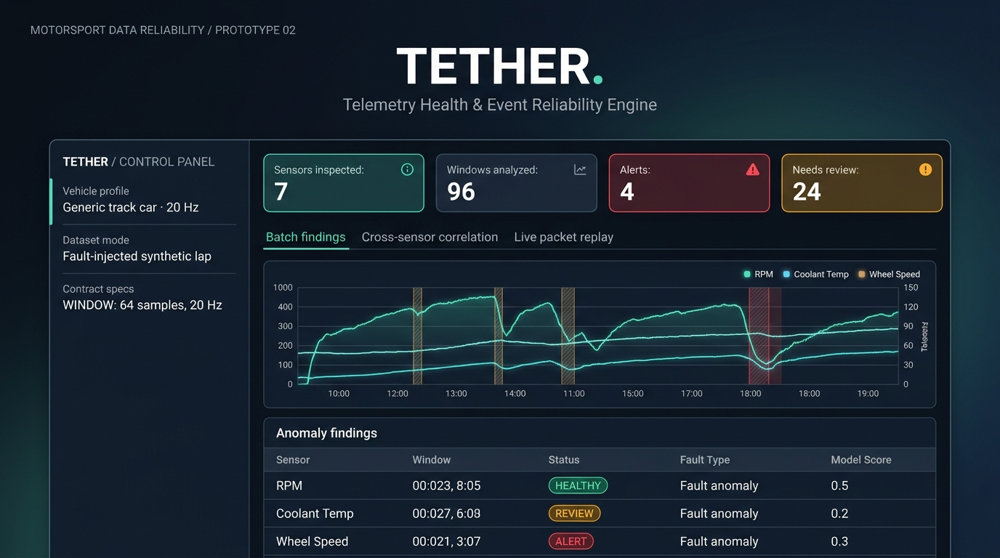
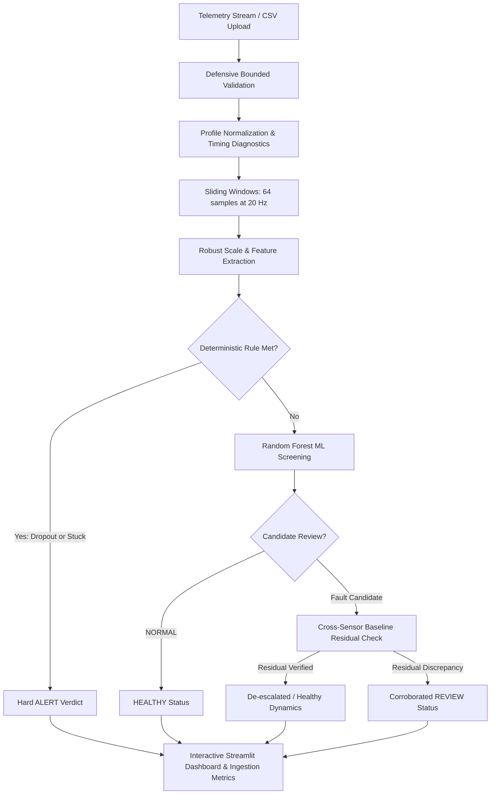

<div align="center">

# TETHER
### Telemetry Health & Event Reliability Engine

**Trust the signal before trusting the decision.**

A lightweight, CPU-first motorsport telemetry integrity gate combining machine-learning classification, deterministic checks, trusted cross-sensor baselines, and real-time streaming packet ingestion.

[](https://tether-telemetry-integrity.streamlit.app/)

[](https://www.python.org/)
[](cpp/)
[](tests/)
[](SECURITY.md)
[](LICENSE)

---

### 🌐 [Launch Live Interactive Dashboard](https://tether-telemetry-integrity.streamlit.app/)
*No local installation needed — test synthetic runs, cross-sensor residuals, and streaming packet replays directly in your browser.*

---



</div>

---

## ⚡ Overview

A race engineering dashboard can only be as trustworthy as the signals it receives. Sensor dropouts, frozen values, drift, isolated spikes, high-frequency electrical noise, timestamp discontinuities, and packet drops can lead engineers to investigate false leads or make costly trackside decisions.

A major challenge in automotive telemetry is **distinguishing legitimate dynamics from true sensor faults**:
- Vehicle behavior is physically coupled and dynamically volatile.
- RPM varies nonlinearly with vehicle speed and gear.
- Speed derivatives broadly correlate with longitudinal acceleration, but throttle and speed do not follow a simple stationary line.
- Naive static thresholding causes overwhelming false positives during hard acceleration, aggressive braking, or gear changes.

TETHER implements a **dual-layer integrity architecture**:

1. **Signal-Local Screening:** A compact CPU Random Forest alongside deterministic integrity rules catches hard dropouts (packet loss) and frozen sensors (`STUCK`) deterministically. Ambiguous single-channel patterns stay flagged for review.
2. **Cross-Sensor Baseline Verification:** Compares suspect channels against a trusted, vehicle-specific relationship baseline (e.g. RPM vs. road speed conditioned on gear, speed derivative vs. longitudinal acceleration with lag compensation). Healthy cross-sensor correlation de-escalates false alarms, while discrepancies confirm genuine sensor drift or bias.

> **Note:** TETHER is an independent educational engineering prototype in the vehicle telemetry domain. It does not use private team telemetry and is not affiliated with any racing organization.

---

## 🎯 What is in v1.1.0

| Capability | Engineering Implementation |
|---|---|
| **Lightweight ML Classifier** | CPU-friendly Random Forest (64 trees, depth 10) trained in-memory from deterministic physics-informed signals |
| **Deterministic Rules** | Zero-latency hard-alert triggers for signal dropouts (≥20% missing) and flatline freezes (≥72% flatline, low variance) |
| **Channel Profiles** | Versioned JSON schemas (`config/`) specifying canonical names, operating envelopes, sample rates (20 Hz), and relationships |
| **Trusted Baselines** | Dynamic calibration against clean reference runs; gear-conditioned RPM–speed regressions and acceleration models |
| **Cross-Sensor Residuals** | Residual z-score monitoring with lag optimization to corroborate or de-escalate candidate findings |
| **Timing & Packet Quality** | Nanosecond-aware timestamp regression detection, packet sequence gap counters, and jitter analysis |
| **Streaming Replay Engine** | Real-time, packet-by-packet sliding-window ingestion buffer with bounded memory footprint |
| **Native C++17 Kernel** | Optional C++17 acceleration residual computation via `ctypes` with automatic NumPy fallback |
| **Authenticated Ingestion API** | Optional FastAPI token-guarded HTTP endpoint enforcing telemetry JSON Schema v1.0.0 |
| **Defensive CSV Intake** | Strict UTF-8 verification, dimension bounds (≤20,000 rows × 40 cols, ≤5 MB), null-byte prevention |

---

## 🚀 Quick Start

### Option 1: Live Web Demo (Instant)
Visit **[tether-telemetry-integrity.streamlit.app](https://tether-telemetry-integrity.streamlit.app/)** to explore the active prototype immediately.

### Option 2: Local Installation

**Prerequisites:** Python 3.11 recommended (Python 3.10+ supported). No GPU or external services required.

```bash
# 1. Clone repository
git clone https://github.com/syubidin/tether-telemetry-integrity.git
cd tether-telemetry-integrity

# 2. Setup virtual environment
# Windows PowerShell:
py -3.11 -m venv .venv
.\.venv\Scripts\Activate.ps1

# macOS / Linux:
python3.11 -m venv .venv
source .venv/bin/activate

# 3. Install dependencies
python -m pip install --upgrade pip
pip install -r requirements-dev.txt

# 4. Launch the dashboard
streamlit run app.py
```

Open your browser at `http://localhost:8501`.

---

## 🖥️ Dashboard Walkthrough

1. **Active Profile:** Select **Generic track car · 20 Hz** for bundled motorsport examples or **Vehicle CAN passenger car · 20 Hz** for production CAN datasets.
2. **Telemetry Source:**
   - **Clean synthetic lap:** Baseline run with normal vehicle dynamics and healthy signal correlations.
   - **Fault-injected synthetic lap:** Contains deliberate sensor anomalies (RPM dropouts, frozen oil pressure, throttle spikes, noisy speed, coolant drift).
   - **Upload a CSV:** Upload your own comma-separated telemetry with an optional reference baseline CSV.
3. **Tabs & Deep Dives:**
   - **Batch findings:** Inspect windowed health classifications, severity levels, suggested engineering actions, and time-series plots.
   - **Cross-sensor correlation:** Analyze residual deviations against trusted physical relationships.
   - **Live packet replay:** Replay individual packets through the bounded streaming buffer and simulate dropped packet sequences.
   - **Contracts & API:** Inspect JSON schemas and FastAPI endpoint integration specs.

---

## 🔬 Architecture Flow



---

## 📦 Real-Time Packet Replay & Streaming API

### Local Packet Replay
Simulate real-time vehicle-to-pitwall telemetry ingestion through a bounded in-memory sliding window:

```bash
python scripts/replay_stream.py --limit 256
```

### Authenticated Ingestion REST API
Start the lightweight FastAPI ingestion service:

```powershell
# Windows PowerShell
$env:TETHER_API_TOKEN = (python -c "import secrets; print(secrets.token_urlsafe(32))")
uvicorn tether.api:app --app-dir src --host 127.0.0.1 --port 8000
```

```bash
# macOS / Linux
export TETHER_API_TOKEN="$(python -c 'import secrets; print(secrets.token_urlsafe(32))')"
uvicorn tether.api:app --app-dir src --host 127.0.0.1 --port 8000
```

Stream packets programmatically:

```bash
python scripts/send_demo_stream.py --limit 128
```

#### API Endpoints Summary

| Endpoint | Method | Authorization | Function |
|---|---|---|---|
| `/health` | GET | Public | Service liveness probe |
| `/v1/telemetry/packet` | POST | Bearer Token | Ingest & validate a single telemetry packet |
| `/v1/telemetry/metrics` | GET | Bearer Token | Ingestion latency, packet counters, and gap statistics |

---

## ⚡ Optional Native C++17 Kernel

For performance-critical environments, TETHER includes a high-throughput C++17 residual kernel:

```bash
cmake -S cpp -B build -DCMAKE_BUILD_TYPE=Release
cmake --build build --config Release --parallel
ctest --test-dir build --output-on-failure
```

*Note: If no C++ compiler or shared library is found, TETHER automatically falls back to NumPy with identical mathematical parity.*

Verify native availability:
```bash
python -c "import sys; sys.path.insert(0, 'src'); from tether.native import native_available; print('C++ Kernel Available:', native_available())"
```

---

## 📊 Evaluation & Verification Benchmarks

### 1. Synthetic Hold-Out Classification Accuracy
Evaluated on a 25% stratified hold-out split (330 windows; 55 samples/class) using `scripts/evaluate_model.py`:

| Class | Precision | Recall | F1-Score | Support |
|---|---:|---:|---:|---:|
| **DROPOUT** | 1.000 | 1.000 | 1.000 | 55 |
| **STUCK** | 1.000 | 1.000 | 1.000 | 55 |
| **SPIKE** | 1.000 | 1.000 | 1.000 | 55 |
| **NOISE** | 0.930 | 0.964 | 0.946 | 55 |
| **DRIFT** | 0.810 | 0.927 | 0.864 | 55 |
| **NORMAL** | 0.956 | 0.782 | 0.860 | 55 |
| **Macro Average** | **0.949** | **0.945** | **0.945** | **330** |

### 2. Controlled 30-Minute Fault-Injection Benchmark
Reproducible experiment executed via `scripts/evaluate_injected_faults.py` (documented in `reports/injected_fault_metrics.json`):

| Fault Type | Target Channel | Precision | Recall | F1 | Detection Delay |
|---|---|---:|---:|---:|---:|
| **DROPOUT** | `rpm` | 1.00 | 1.00 | 1.00 | 3.2 s (64 samples) |
| **STUCK** | `oil_pressure_bar` | 1.00 | 1.00 | 1.00 | 3.2 s (64 samples) |
| **SPIKE** | `throttle_pct` | 1.00 | 1.00 | 1.00 | 3.2 s (64 samples) |
| **NOISE** | `speed_kph` | 1.00 | 1.00 | 1.00 | 3.2 s (64 samples) |
| **RPM Drift** | Gear-conditioned residual | 1.00 | 1.00 | 1.00 | 3.2 s (64 samples) |
| **Accel Bias** | Speed derivative vs. Accel | 1.00 | 1.00 | 1.00 | 3.2 s (64 samples) |

---

## 🛡️ Security, Privacy & Discipline

- **In-Memory Execution:** Uploaded files and fitted baselines exist strictly in transient RAM and are never written to disk.
- **Untrusted Model Guard:** TETHER **never** unpickles user-supplied `.pkl` or `.joblib` files; models are trained strictly from version-controlled, synthetic generators.
- **Strict Boundary Defenses:** CSV inputs are constrained to 5 MB, 20,000 rows, and 40 channels. API payloads are capped at 8 KiB.
- **Automated CI Security Pipeline:** Every commit and PR is verified using Ruff, Bandit SAST security scans, pip-audit CVE vulnerability detection, and unit testing across Python 3.11 and 3.12.

---

## 🗺️ Repository Structure

```text
.
├── app.py                         # Streamlit interactive dashboard
├── src/tether/                    # Core Python engine
│   ├── analysis.py                # Single-channel rules & ML inference
│   ├── api.py                     # FastAPI ingestion service
│   ├── baseline.py                # Reference baseline calibration
│   ├── cross_sensor.py            # Multichannel physical residuals
│   ├── features.py                # Robust statistical feature extraction
│   ├── model.py                   # In-memory Random Forest classifier
│   ├── native.py                  # C++17 ctypes bridge & NumPy fallback
│   ├── profiles.py                # Vehicle channel profile validation
│   ├── quality.py                 # Timing diagnostics & operating envelopes
│   ├── streaming.py               # Real-time packet ring buffer
│   └── validation.py              # CSV defensive parsing
├── config/                        # Channel profile definitions (20 Hz)
├── contracts/                     # Versioned JSON Schemas & Model Card
├── cpp/                           # Native C++17 acceleration kernel
├── data/                          # Deterministic synthetic test CSVs
├── docs/                          # Architecture, security & case study docs
├── reports/                       # Benchmark JSON reports
├── scripts/                       # Replay, conversion & evaluation utilities
└── tests/                         # 32 unit and integration tests
```

---

## 📄 License

Distributed under the **MIT License**. See [LICENSE](LICENSE) for details.
